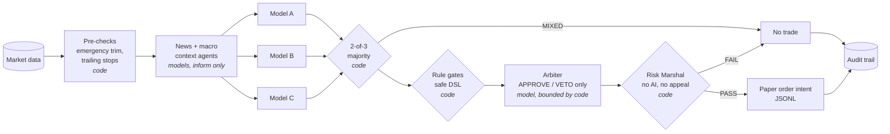

# multi-llm-trading-committee

**LLMs propose, deterministic code disposes.**

A multi-model "investment committee" for equities: three models vote in
parallel, a strict majority sets direction, a veto-only arbiter can narrow but
never flip the decision, and a pure-Python Risk Marshal has the final word.
Every decision is written to an audit trail.

> **Paper-traded engineering project; no live capital; no alpha claimed.**
> The original system traded a broker *paper* account. It lost a little money
> and had no measurable edge (see [Production context](#production-context) and
> [docs/LESSONS.md](docs/LESSONS.md)). This repository exists to show the
> engineering: how to put language models in a loop with money-shaped
> decisions without letting them hold the pen.

## The problem

Language models are useful for reading messy context (news, price structure,
regime) and bad at being a hard constraint. Ask one model for a trade and you
get one confident opinion. Ask it to also enforce risk limits and a fluent
rationale will eventually talk it out of them. The design question is where
the models' authority ends.

## Architecture



More detail, including failure semantics and a who-may-do-what table, is in
[docs/architecture.md](docs/architecture.md).

## Design rules

1. **Deterministic code has the last word.** The Risk Marshal
   (`risk_marshal/`) is pure Python with immutable constants: 5% max position,
   20% max sector, at most 3 correlated holdings (|r| >= 0.7), 3 new positions
   and 10% of NAV deployed per day, stops no wider than 5%. Drawdown modes at
   5% (warn), 10% (no new buys) and 15% (sell/cover only). VIX >= 25 halves
   size; VIX >= 35 freezes new positions. Output is a typed `RiskVerdict` with
   machine-readable `Violation`s. The constants raise on assignment, and the
   class takes no configuration.
2. **Majority, not a single oracle.** Three different models get the same prompt
   concurrently (`asyncio.gather`). Direction needs 2 of 3. A failed member is an
   abstention that still counts in the denominator.
3. **The arbiter can only narrow.** It may approve, or veto citing one reason from
   a whitelist of risk reasons. It cannot flip direction or change the action;
   attempts are stripped and logged. "Technicals disagree" is explicitly not a
   valid veto. Machine-readable data blockers (stale quotes, toxic spreads, no
   fill, earnings within 3 days) veto without asking a model. If the arbiter is
   down, the ruling fails closed.
4. **Every model output is a contract.** Agents validate JSON against a schema,
   extract JSON from prose or fenced blocks, retry with the validation error as
   feedback, and fail with a typed error (`AgentParseError`,
   `AgentValidationError`, `AgentCallError`).
5. **No `eval`.** Rule triggers such as
   `news.catalyst_flag == true AND agents_bullish < 3` are tokenized and parsed by
   a recursive-descent parser. Unknown keys, type mismatches and syntax errors
   mean "no match".
6. **Stops only tighten.** Giveback tiers (35/25/20% of peak open profit at
   15/25/35% gain), a 0.2% no-insta-trigger buffer, a breakeven lock, and
   idempotent updates.
7. **Everything is auditable.** One JSON snapshot per decision, including
   no-trades: inputs, each model's opinion, the ruling, the verdict, the intent.
8. **No broker code.** The cycle ends at an append-only JSONL of paper order
   intents. Keys are read from the environment only.

## Run it

Requires Python 3.11+. No third-party runtime dependencies.

```bash
make demo            # one full committee cycle, offline: python demo.py --mock
make demo-debate     # plus the debate ranker on synthetic ideas
make test            # pytest -q
```

The offline demo uses canned model outputs (`data/fake_market/mock_responses.json`)
and fictional tickers, and is built to hit every gate once:

```text
[2-7] Per-ticker decisions
    ticker stopped at    result     detail
    ACME   intent        INTENT     BUY 1500 (VIX at 26.4 (>= 25). Position size reduced from 3.0% to 1.5%)
    BOLT   risk_marshal  RISK_FAIL  STOP_LOSS_TOO_WIDE
    CRUX   proposal      NO_TRADE   no 2/3 majority on direction
    DYNA   arbiter       VETOED     SPREAD_TOXIC: max bid/ask spread 2.4% exceeds 1.5% limit
    EMBR   arbiter       VETOED     R_MULTIPLE_BELOW_1: Reward to target 1.6 vs risk 2.2 (R=0.8).
    GLOW   rules         NO_TRADE   SKIP pattern CATALYST_WITHOUT_UNANIMITY
```

Before any model runs, the pre-checks also write an emergency trim for a
position above 25% of NAV and tighten a trailing stop. One council member's
first reply fails its schema and is retried; another provider times out and
abstains. BOLT shows the arbiter's "technicals disagree" veto being ignored
and the trade still dying at the Risk Marshal. EMBR shows a valid veto while
the arbiter's attempted flip to SHORT is stripped.

Outputs land in `./out/` (git-ignored): `order_intents.jsonl` and
`audit/<date>/<cycle>/<TICKER>.json`. A sample snapshot is in
[docs/sample_audit_snapshot.json](docs/sample_audit_snapshot.json).

**Live models (optional):** copy `.env.example` to `.env`, export
`OPENROUTER_API_KEY`, and run `python demo.py`. Any OpenAI-compatible endpoint
works via `LLM_BASE_URL`. It is still paper-only: there is nothing to place an
order with.

## Tests

`pytest -q` runs about 370 tests offline in a couple of seconds:

- `test_risk_marshal.py`: every rule, every boundary, immutability, ordering and determinism
- `test_consensus.py`: majority maths, parallelism, abstentions, proposal guards, every arbiter overreach path
- `test_base_agent.py`: JSON extraction variants, schema validation, retry-with-feedback, typed errors, providers
- `test_rule_engine.py`: precedence, strings containing operators, injection attempts, fail-closed evaluation, tiers
- `test_trailing_stops.py`, `test_audit_trail.py`, `test_debate_ranker.py` (leak guard, blind judge never sees the price)
- `test_cycle.py`: the whole cycle end to end, plus a check that no broker client is imported anywhere
- `test_prompts.py`: every role prompt has "You do NOT" boundaries and a parseable JSON contract
- `test_dataset_hygiene.py`: fails on real-looking phones/emails, IP literals, account ids, or private identifiers

CI runs the tests on Python 3.11 to 3.13, runs the offline demo, and runs gitleaks.

## Debate ranker

`debate/debate_ranker.py` is a separate research tool generalized from a sibling
project: a neutral research pass, two models arguing opposite outcomes (which model
argues which side is decided by a hash of the case id, so advocate bias is
measurable), a judge that gives a **blind** probability without seeing the price,
then a **priced** 1-10 score against the market-implied probability. A leak guard
refuses any case whose event window has already opened. It has no path to an order.

## Production context

- Paper-traded on a broker paper account for about four weeks, with scheduled
  autonomous checkpoints through the trading day. No live capital.
- Result: paper NAV **-0.95%**, max drawdown **-7%**, **35%** win rate on **205**
  trades against a **46.8%** break-even win rate. No edge.
- The original backtests were self-audited and found to be meaningless (simulated
  prices with pre-assigned edges). That story is in [docs/LESSONS.md](docs/LESSONS.md).
- The models used over the project's life were GPT-4o, Gemini, Grok and Claude,
  routed through a provider-agnostic layer.

## What was simplified

- **Data:** all market data, news and model outputs here are synthetic. Vendor
  feeds (prices, options analytics, macro series, news) are replaced by
  `data/fake_market/`.
- **Execution:** the broker integration, order types and fill handling were
  removed entirely. The cycle stops at a paper order-intent log.
- **Persistence:** Postgres logging and watermark tables became an in-memory store,
  JSONL logs and JSON snapshots.
- **Routing:** a LiteLLM-based router became a small stdlib OpenRouter-compatible
  client plus a mock. Extended-thinking options were dropped.
- **Validation:** the `jsonschema` dependency became a small built-in validator for
  the subset of JSON Schema the contracts use.
- **Rule engine:** the original split on ` AND `/` OR ` strings. It is now a real
  tokenizer and parser (so operators inside quoted strings are safe, and
  parentheses and `NOT` work). Patterns load from JSON instead of a YAML strategy
  file, and a pattern with no significance test no longer qualifies for a tier.
- **Risk Marshal:** ported faithfully. Two additions: the sector cap can use a
  sector supplied on the trade card (the original only knew sectors of existing
  holdings), and a non-positive NAV fails closed. The learning-mode enforcer takes
  an injected sector map instead of a hard-coded one.
- **Not included:** the factor-discovery loop, the Brier-scored "historian" weight
  updater, strategy rulebooks and factor libraries, investor-persona prompts,
  reports, and every dataset from the original system. The sequential
  equity-to-options variant is represented by its prompts and schemas
  (`prompts/equity_trader.md`, `prompts/options_trader.md`) but is not wired
  into the demo cycle.

## Credits

Some early multi-model consultation experiments used the open-source PAL MCP
Server (Apache-2.0, third-party). None of its code is included here.

## License

MIT. See [LICENSE](LICENSE).
