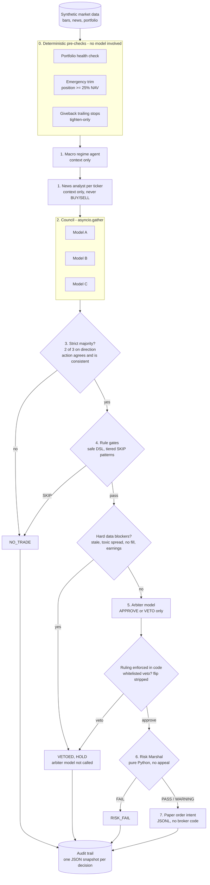
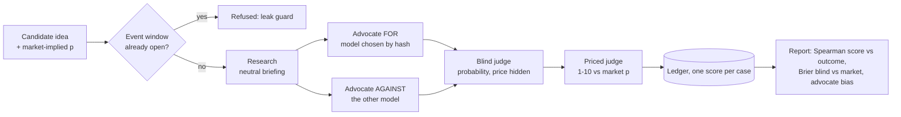

# Architecture

The design rule is one sentence: **LLMs propose, deterministic code disposes.**
Every model in the pipeline can only add information or narrow the set of
allowed actions. Nothing a model says can widen a risk limit, flip a majority
direction, or reach an order without passing the Risk Marshal.

## One cycle

## Who may do what

| Layer | Kind | May | May not |
|---|---|---|---|
| Pre-checks | code | trim a position above 25% NAV, tighten stops | consult a model |
| News analyst | model | classify headlines, flag catalysts | recommend trades |
| Macro regime | model | set regime, shrink risk multiplier | name stocks, grow risk |
| Council (x3) | models | vote direction and action, suggest stop/target | size the trade, see each other |
| Proposal | code | turn a strict majority into a trade card | trade on MIXED or contradictory votes |
| Rule gates | code | SKIP on tiered patterns | run arbitrary code (`eval` is never used) |
| Arbiter | model | APPROVE, or VETO from a whitelist of risk reasons | flip direction, change action or size |
| Arbiter ruling | code | strip overreach, apply data blockers, fail closed | trust the arbiter's direction field |
| Risk Marshal | code | FAIL, PASS, or PASS-with-WARNING and halve size | be configured, overridden or appealed |
| Order intent | code | append a JSON line | talk to a broker |

## Failure semantics

| Failure | Behaviour |
|---|---|
| A council member times out or returns junk after retries | abstention; still counts in the denominator, so the survivors must both agree |
| Model returns prose around JSON, or a fenced block | extracted (`agents/base_agent.py::extract_json`) |
| Model JSON fails the schema | retried with the validation error as feedback, then a typed `AgentValidationError` |
| Arbiter unavailable | fail closed: `ARBITER_UNAVAILABLE`, HOLD |
| Arbiter vetoes with "technicals disagree" | veto ignored and logged; trade still faces the Risk Marshal |
| Arbiter tries to flip BULLISH to BEARISH | flip stripped and logged; its APPROVE/VETO still applies |
| Trigger expression references a missing key or is malformed | trigger does not match; error recorded |
| Anything not a typed agent error inside the council | re-raised. A bug is not a vote |

## Module map

| Path | Role |
|---|---|
| `risk_marshal/` | immutable constants, drawdown modes, VIX gates, sector/correlation/daily caps, typed `RiskVerdict` / `Violation`, learning-mode enforcer |
| `consensus/council.py` | parallel council and `calculate_consensus` |
| `consensus/proposal.py` | deterministic consensus to trade card |
| `consensus/arbiter.py` | veto whitelist, data blockers, `rule()` |
| `agents/base_agent.py` | prompt loading, provider routing, JSON extraction, schema validation, retries, typed errors |
| `providers/` | OpenRouter-compatible HTTP client (stdlib) and a canned-JSON mock |
| `rules/rule_engine.py` | tokenizer + recursive-descent trigger DSL, tiered pattern engine |
| `stops/trailing_stops.py` | giveback tiers, monotonic watermark, idempotent updates |
| `audit/audit_trail.py` | atomic per-decision JSON snapshots |
| `debate/debate_ranker.py` | research, side-randomized advocates, blind judge, priced judge |
| `committee/cycle.py` | wires one cycle together |
| `prompts/` | role prompts with explicit "You do NOT" boundaries |

A sample decision snapshot produced by `make demo` is in
[`sample_audit_snapshot.json`](sample_audit_snapshot.json).

## Debate ranker

